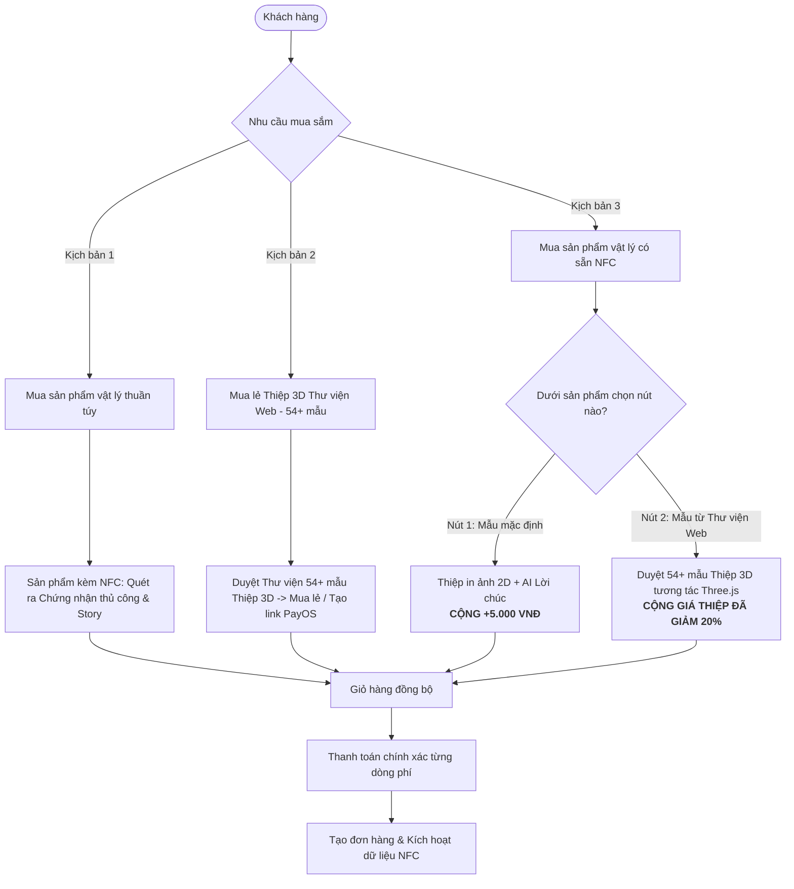
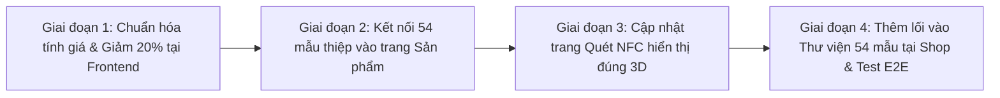

# 📐 Kế Hoạch Triển Khai Kiến Trúc Đa Luồng (v4.0 - Production-Ready): Sản Phẩm Vật Lý, Thư Viện 54+ Thiệp 3D Web & Combo NFC (Mẫu Mặc Định / Thư Viện Web)

> [!IMPORTANT]
> **Bản cập nhật v4.0 (Đã tinh chỉnh theo kiến trúc thực tế của hệ thống CraftVision 3D):**
> 1. **Bảo toàn 100% nghiệp vụ trọng tâm của bạn:**
>    - **Kịch bản 1:** Mua sản phẩm vật lý thuần túy (quét chip NFC mở Chứng nhận chế tác thủ công & Câu chuyện sản phẩm).
>    - **Kịch bản 2:** Mua lẻ độc lập **54+ mẫu Thiệp 3D từ Thư viện Web** (không trùng lặp với thiệp mặc định, hỗ trợ xem/xoay 3D, thanh toán và tạo link chia sẻ công khai).
>    - **Kịch bản 3:** Dưới sản phẩm vật lý có **2 nút lựa chọn rõ ràng**:
>      - **Nút 1: "Mẫu mặc định"** (+5.000 VNĐ vào tổng đơn hàng, AI câu chúc & in ảnh 2D).
>      - **Nút 2: "Mẫu thiệp từ thư viện Web"** (Duyệt toàn bộ 54+ mẫu thiệp 3D thực tế, tùy chỉnh và **giảm ngay 20% giá thiệp** khi mua kèm).
> 2. **Giải pháp kỹ thuật Zero-Migration (An toàn tuyệt đối cho Cloud / Render):**
>    - **KHÔNG tạo bảng thừa `Card3dTemplate`** và **KHÔNG sửa bảng `order_items`** trong database chính để tránh lỗi xung đột Foreign Key / Crash `Exit 139` khi deploy trên Render (`db.Database.Migrate()`).
>    - Tận dụng 100% các trường backend hiện có: `ExtraPrice` trên `CreateOrderItemDto` và `ThreeDModelUrl` trên thực thể `Gift`.
>    - Sử dụng nền tảng **54+ mẫu thiệp Three.js Procedural (`models.ts`) siêu nhẹ** có sẵn thay vì tải các file `.glb` nặng 70MB–88MB.
>    - Thay thế mô hình `Astronaut.glb` đang hardcode tại trang quét NFC bằng đúng mẫu thiệp 3D tương ứng.

---

## 🔍 BÁO CÁO RÀ SOÁT MÃ NGUỒN HIỆN TẠI

Qua kiểm tra trực tiếp các tệp tin trong hệ thống:
- [`frontend/src/app/shop/[id]/page.tsx`](file:///d:/03_Dev/01_Projects/01_MyProject/04_GitHub/EXE201/1/CraftVision_3D/frontend/src/app/shop/[id]/page.tsx#L423-L492)
- [`frontend/src/app/shop/[id]/greeting/page.tsx`](file:///d:/03_Dev/01_Projects/01_MyProject/04_GitHub/EXE201/1/CraftVision_3D/frontend/src/app/shop/[id]/greeting/page.tsx#L68-L111)
- [`frontend/src/features/cards/catalog.ts`](file:///d:/03_Dev/01_Projects/01_MyProject/04_GitHub/EXE201/1/CraftVision_3D/frontend/src/features/cards/catalog.ts) & [`models.ts`](file:///d:/03_Dev/01_Projects/01_MyProject/04_GitHub/EXE201/1/CraftVision_3D/frontend/src/features/cards/models.ts)
- [`backend/src/CraftVision.Application/Services/OrderService.cs`](file:///d:/03_Dev/01_Projects/01_MyProject/04_GitHub/EXE201/1/CraftVision_3D/backend/src/CraftVision.Application/Services/OrderService.cs#L112-L125)
- [`backend/src/Services/CardSharing`](file:///d:/03_Dev/01_Projects/01_MyProject/04_GitHub/EXE201/1/CraftVision_3D/backend/src/Services/CardSharing)
- [`frontend/src/app/gift/scan/[secretKey]/page.tsx`](file:///d:/03_Dev/01_Projects/01_MyProject/04_GitHub/EXE201/1/CraftVision_3D/frontend/src/app/gift/scan/[secretKey]/page.tsx#L245)

### 📌 Kết quả đối soát:
1. **Về Mẫu mặc định (+5.000 VNĐ):**
   - Tại `greeting/page.tsx` và `OrderService.cs`, hệ thống **ĐÃ CÓ** logic cộng 5.000 VNĐ (`defaultProductTemplate.price = 5000`, `extraFee = itemDto.ExtraPrice ?? (itemDto.WantNfc ? 5000m : 0m)`).
   - Tuy nhiên ở Giỏ hàng và Checkout, nhãn hiển thị phụ phí cần làm rõ ràng hơn cho khách hàng an tâm.
2. **Về Mẫu thiệp từ thư viện Web:**
   - Trang chi tiết sản phẩm (`/shop/[id]`) đang gắn nhãn cũ *"16 mẫu 3D"* và trỏ vào danh sách giả lập `templateProducts.ts`, **chưa kết nối với Thư viện 54+ mẫu thật** trong `features/cards/catalog.ts`.
   - **Chưa có công thức giảm 20%:** Giá thiệp thư viện khi đính kèm vào sản phẩm đang tính nguyên giá 100% thay vì ưu đãi combo giảm 20%.
3. **Về Trang quét NFC (`/gift/scan/[secretKey]`):**
   - Hiện tại đang hardcode đường link mô hình mẫu của Google: `https://modelviewer.dev/shared-assets/models/Astronaut.glb`, chưa hiển thị cảnh 3D tương tác của mẫu thiệp được chọn.

---

## 1. Mô Hình Tổng Quan & 3 Kịch Bản Nghiệp Vụ



---

## 2. Ma Trận So Sánh 3 Kịch Bản

| Tiêu chí | Kịch bản 1: Mua sản phẩm vật lý riêng | Kịch bản 2: Mua lẻ Thiệp 3D Web (54+ mẫu) | Kịch bản 3 - Lựa chọn A: Sản phẩm + Thiệp Mặc Định | Kịch bản 3 - Lựa chọn B: Sản phẩm + Thiệp Thư Viện Web |
| :--- | :--- | :--- | :--- | :--- |
| **Bản chất mặt hàng** | Vòng tay, móc khoá, charm thủ công... | Thiệp 3D số chọn trong Thư viện web (54+ mẫu) | Sản phẩm vật lý + Thẻ thiệp in kèm NFC | Sản phẩm vật lý + Thiệp 3D tương tác lưu vào NFC |
| **Chip NFC** | ✅ Có sẵn trên sản phẩm | ❌ Không có (quà tặng online qua link) | ✅ Dùng chip NFC của sản phẩm | ✅ Dùng chip NFC của sản phẩm |
| **Hình thức thiệp** | ❌ Không có thiệp | ✅ Mẫu thiệp 3D Three.js tùy biến lời chúc, ảnh | Thẻ in ảnh phẳng 2D + Lời chúc AI | Mẫu thiệp 3D tương tác Three.js từ kho 54+ mẫu |
| **Công thức tính giá** | `Tổng = Giá sản phẩm` | `Tổng = Giá thiệp 3D` (29k - 49k) | **`Tổng = Giá sản phẩm + 5.000 VNĐ`** | **`Tổng = Giá sản phẩm + (Giá thiệp 3D × 0.8)`** *(Giảm 20% giá thiệp)* |
| **Trải nghiệm khi quét NFC** | Mở trang **Chứng nhận chế tác thủ công** (Craft Story & Certificate) | *(Xem qua web link /love-gift/s/{token})* | Mở trang lời chúc + ảnh kỷ niệm in 2D | Mở **Thiệp 3D tương tác xoay 360 độ** của đúng mẫu đã chọn |

---

## 3. Thiết Kế Trải Nghiệm Người Dùng (UX/UI Flows)

### 3.1. Luồng Kịch bản 1: Mua sản phẩm vật lý riêng lẻ
- Người dùng vào trang chi tiết sản phẩm vật lý (`/shop/[id]`).
- Chọn số lượng và nhấn trực tiếp **"Thêm vào giỏ hàng"** (`hasGreeting = false`).
- Giỏ hàng ghi nhận sản phẩm thuần túy với giá gốc niêm yết.
- Khi người nhận quét chip NFC trên sản phẩm, hệ thống hiển thị trang **Chứng nhận nguồn gốc & Câu chuyện chế tác thủ công** (Story & Craftsmanship Certificate).

---

### 3.2. Luồng Kịch bản 2: Mua lẻ Thiệp 3D độc lập từ Thư viện Web (54+ mẫu)
- **Điểm truy cập trên web:**
  - Tab hoặc banner tại `/shop`: **"Thư viện Thiệp 3D nghệ thuật (54+ mẫu)"** trỏ sang `/cards`.
  - Hoặc truy cập trực tiếp danh mục `/cards`.
- **Tại Thư viện Thiệp 3D (`/cards`):**
  - Hiển thị đầy đủ 54 mẫu thiệp phân chia theo 9 chủ đề: *Tình yêu, Sinh nhật, Tết & Năm mới, Gia đình, Tri ân, Thiếu nhi, Giáng sinh & Halloween, Ngày lễ, Dịp cá nhân*.
  - Nhấn vào mẫu thiệp để xem trước 3D tương tác xoay lật, hiệu ứng hoa rơi, ánh nến...
- **Cá nhân hóa & Mua:**
  - Khách điền lời chúc, tải ảnh kỷ niệm, chọn màu sắc tại `/cards/[slug]/edit`.
  - Khách có thể **Thanh toán QR qua PayOS** để tạo link gửi online (`/love-gift/s/[token]`), hoặc nhấn **"Thêm vào giỏ hàng"** để thanh toán chung với giỏ hàng. Giá bán là giá lẻ gốc của thiệp (29.000đ – 49.000đ theo `card-prices.json`).

---

### 3.3. Luồng Kịch bản 3: Mua sản phẩm vật lý có sẵn NFC (2 Nút lựa chọn dưới sản phẩm)
Tại trang chi tiết sản phẩm vật lý (`/shop/[id]`), bên dưới nút "Thêm vào giỏ hàng", bố trí **khung 2 lựa chọn tích hợp thiệp vào chip NFC**:

```
┌────────────────────────────────────────────────────────────────────────┐
│ 🎁 TÙY CHỌN TÍCH HỢP THIỆP VÀO CHIP NFC CỦA SẢN PHẨM                   │
│ (Sản phẩm của bạn đã có sẵn chip NFC thông minh)                       │
│                                                                        │
│  [🔘 Nút 1: Thiết kế câu chúc riêng - Mẫu Mặc Định (+5.000đ)]          │
│  • Tích hợp thẻ in ảnh kỷ niệm 2D & Lời chúc AI tự động sinh           │
│                                                                        │
│  [🎨 Nút 2: Chọn mẫu từ Thư Viện Thiệp 3D (Ưu đãi -20% giá thiệp)]     │
│  • Chọn từ kho 54+ mẫu thiệp 3D nghệ thuật đỉnh cao                    │
│  • Trải nghiệm xoay 360 độ tương tác khi chạm điện thoại vào sản phẩm  │
└────────────────────────────────────────────────────────────────────────┘
```

#### Khi người dùng nhấn Nút 1: "Mẫu Mặc Định"
1. Chuyển sang `/shop/[id]/greeting?mode=default`.
2. Khách nhập tên người gửi, người nhận, dùng AI tạo câu chúc hoặc tự viết, tải ảnh in thẻ 2D.
3. **Tính giá:**
   $$\text{Đơn giá} = \text{Giá sản phẩm} + 5.000\text{ VNĐ}$$
4. Giỏ hàng và Checkout hiển thị rõ ràng:
   - *Giá sản phẩm:* Ví dụ 85.000đ
   - *Phụ phí thiệp NFC mặc định:* +5.000đ
   - *Tổng đơn giá dòng:* 90.000đ

#### Khi người dùng nhấn Nút 2: "Mẫu Thiệp Từ Thư Viện Web"
1. Hệ thống mở danh mục chọn trong **54+ mẫu Thiệp 3D thực tế** (lấy từ `features/cards/catalog.ts`).
2. **Khách hàng duyệt & chọn mẫu:**
   - Xem 3D xoay lật của từng mẫu thiệp.
   - Hiển thị rõ giá gốc và giá combo ưu đãi (ví dụ: Thiệp hoa hồng giá gốc 49.000đ $\rightarrow$ giảm 20% còn **39.200đ**).
3. **Cá nhân hóa:** Tùy biến thông điệp, hình ảnh, màu sắc của mẫu thiệp 3D đã chọn.
4. **Tính giá:**
   $$\text{Giá thiệp ưu đãi} = \text{Round}(\text{Giá gốc thiệp} \times 0.8)$$
   $$\text{Tổng đơn giá dòng} = \text{Giá sản phẩm} + \text{Giá thiệp ưu đãi}$$
5. Giỏ hàng và Checkout hiển thị chi tiết:
   - *Sản phẩm chính:* 85.000đ
   - *Thiệp 3D [Tên mẫu]:* ~~49.000đ~~ **39.200đ** `(-20%)`
   - *Tổng đơn giá dòng:* **124.200đ**
6. Khi người nhận chạm điện thoại vào chip NFC của sản phẩm, hệ thống mở đúng **mẫu thiệp 3D tương tác đã chọn**.

---

## 4. Kiến Trúc Kỹ Thuật (Zero-Migration & Clean Architecture)

Để đảm bảo tuân thủ nghiêm ngặt **Quy tắc 6 (An toàn Migration Render)** và **Quy tắc 2 (Microservices Boundary)**, giải pháp triển khai **hoàn toàn KHÔNG sửa đổi schema database**, mà tận dụng tối đa kiến trúc hiện hữu:

### 4.1. Bản Đồ Dữ Liệu Thiệp 3D (Specification & Code-First Catalog)
* **Frontend & Backend Catalog:** Toàn bộ 54 mẫu thiệp, schema trường tùy biến và bảng giá đã được quy chuẩn tại:
  - Specification: [`api-specs/card-prices.json`](file:///d:/03_Dev/01_Projects/01_MyProject/04_GitHub/EXE201/1/CraftVision_3D/api-specs/card-prices.json)
  - Frontend Catalog: [`frontend/src/features/cards/catalog.ts`](file:///d:/03_Dev/01_Projects/01_MyProject/04_GitHub/EXE201/1/CraftVision_3D/frontend/src/features/cards/catalog.ts)
  - 3D Rendering Engine: [`frontend/src/features/cards/models.ts`](file:///d:/03_Dev/01_Projects/01_MyProject/04_GitHub/EXE201/1/CraftVision_3D/frontend/src/features/cards/models.ts)
* **Microservice CardSharing:** Đảm nhiệm toàn bộ việc lưu trữ bản nháp thiệp số độc lập, thanh toán PayOS QR và xuất bản link công khai qua database riêng (`ConnectionStrings:Cards`).

### 4.2. Khớp Nối Đơn Hàng & Kích Hoạt NFC (Không Cần Migration)

Khi tạo đơn hàng từ giỏ hàng, Frontend gửi payload chuẩn tới API `POST /api/orders`:

```json
{
  "receiverName": "Nguyen Van A",
  "receiverPhone": "0912345678",
  "receiverAddress": "123 Đường ABC, Quận 1, TP.HCM",
  "paymentMethod": "Cod",
  "shippingFee": 0,
  "items": [
    {
      "productId": "3fa85f64-5717-4562-b3fc-2c963f66afa6",
      "quantity": 1,
      "wantNfc": true,
      "extraPrice": 39200,
      "gift": {
        "giftTitle": "Thiệp Valentine 14/2 – Ngàn lời yêu trong một đóa hồng",
        "senderName": "Minh",
        "receiverName": "Lan",
        "message": "Chúc em luôn rạng rỡ như đóa hồng này!",
        "theme": "rose-love",
        "messageSource": "Manual",
        "threeDModelUrl": "slug:rose-love",
        "previewImageUrl": "/cards/previews/rose-love.webp",
        "threeDModelType": "GLB"
      }
    }
  ]
}
```

* **Xử lý tại Backend (`OrderService.cs`):**
  - Trường `extraPrice` đã có sẵn: Backend tự động tính `unitPrice = product.Price + extraPrice` (39.200đ đối với thiệp web giảm 20%, hoặc 5.000đ đối với thiệp mặc định).
  - Tự động gán hoặc tạo `NfcTag` với mã bảo mật `SecretKey` và link quét `/gift/scan/{SecretKey}`.
  - Lưu trữ thông tin thiệp vào thực thể `Gift`, trong đó `ThreeDModelUrl` lưu định danh `slug:rose-love` hoặc URL thiệp.

---

## 5. Nâng Cấp Giao Diện & Đồng Bộ Hóa Frontend

### 5.1. Đồng Bộ Hóa Zustand Store (`useWishlistStore.ts`)
Bổ sung hỗ trợ lưu vết loại thiệp và chi tiết giảm giá:

```typescript
export interface CartItem extends Product {
  // ... các trường hiện có
  cardType?: 'none' | 'default' | 'web_library_3d';
  cardSlug?: string;
  originalCardPrice?: number;
  discountedCardPrice?: number;
}
```

### 5.2. Chuyển Đổi Trang Chi Tiết Sản Phẩm (`/shop/[id]/page.tsx`)
- Sửa badge tại Nút 2 từ *"16 mẫu 3D"* thành **"54+ mẫu 3D"**.
- Chuyển hướng Nút 2 sang giao diện chọn mẫu từ Thư viện 54 mẫu (`/shop/[id]/greeting?mode=web3d`).

### 5.3. Nâng Cấp Trang Tạo Lời Chúc (`/shop/[id]/greeting/page.tsx`)
- Thay thế việc import danh sách cũ `INITIAL_TEMPLATE_PRODUCTS` (16 mẫu) bằng danh sách thực tế `cardTemplates` (54 mẫu) từ `features/cards/catalog.ts`.
- Áp dụng công thức tính giá thiệp khi `mode=web3d`:
  ```typescript
  const rawPrice = getCardCommerce(template.slug).salePrice || 49000;
  const comboPrice = Math.round(rawPrice * 0.8); // Giảm 20% khi mua kèm sản phẩm
  ```

### 5.4. Cập Nhật Trang Quét NFC (`/gift/scan/[secretKey]/page.tsx`)
- **Loại bỏ:** Dòng tải `Astronaut.glb` từ Google.
- **Thay thế:**
  - Nếu `gift.threeDModelUrl` chứa tiền tố `slug:` (ví dụ `slug:rose-love`):
    - Nhúng trực tiếp iframe xem trước nhẹ nhàng:
      ```tsx
      <iframe
        src={`/love-gift/${slug}?preview=1`}
        className="w-full h-full border-0 rounded-2xl"
        title="Thiệp 3D tương tác"
      />
      ```
    - Hoặc mount trực tiếp Three.js component `CardViewer` từ `features/cards/CardViewer`.
  - Nếu là Mẫu mặc định: Giữ giao diện thiệp ảnh kỷ niệm 2D phẳng và lời chúc ấm áp.

---

## 6. Lộ Trình Triển Khai 4 Giai Đoạn (Actionable Roadmap)



### Giai đoạn 1: Chuẩn hóa logic giá Combo & Giảm 20%
- Cập nhật hàm tính giá trong `greeting/page.tsx`:
  - Mẫu mặc định: Phụ phí cố định **+5.000 VNĐ**.
  - Mẫu thư viện Web: Phụ phí bằng **Giá thiệp × 0.8** (giảm 20%).
- Đảm bảo `cart/page.tsx` và `checkout/page.tsx` hiển thị minh bạch 2 dòng giá (Giá sản phẩm + Phụ phí thiệp tương ứng).

### Giai đoạn 2: Kết nối Thư viện 54+ mẫu Thiệp 3D vào trang Sản phẩm
- Cập nhật Nút 2 ở trang `/shop/[id]` (đổi badge thành *"54+ mẫu 3D"*).
- Thay thế bộ chọn 16 mẫu cũ trong `greeting/page.tsx` bằng 54 mẫu từ `features/cards/catalog.ts`.
- Cho phép người dùng duyệt theo 9 chủ đề thiệp và xem trước 3D Three.js mượt mà ngay trên trang.

### Giai đoạn 3: Nâng cấp Trang Quét NFC (`/gift/scan/[secretKey]`)
- Xóa bỏ `Astronaut.glb`.
- Kiểm tra `threeDModelUrl` trả về từ API `/api/gifts`:
  - Nếu có slug mẫu 3D: Render khung 3D tương tác của đúng mẫu thiệp từ kho 54 mẫu.
  - Nếu là mẫu mặc định: Render giao diện thẻ in ảnh 2D và câu chúc.

### Giai đoạn 4: Hoàn thiện Lối vào Thư viện Thiệp tại Cửa hàng & Kiểm thử E2E
- Thêm tab/bộ lọc tại `/shop`: *"Thư viện Thiệp 3D"* dẫn sang `/cards`.
- Kiểm thử toàn diện 3 kịch bản:
  1. Mua lẻ sản phẩm: Quét NFC ra trang Certificate.
  2. Mua lẻ thiệp 3D: Mua với giá gốc niêm yết (29k - 49k).
  3. Mua sản phẩm + Thiệp mặc định: Cộng đúng 5.000đ.
  4. Mua sản phẩm + Thiệp web: Cộng đúng giá thiệp đã giảm 20% và quét NFC hiển thị đúng 3D.

---

## 7. Tiêu Chí Nghiệm Thu (Acceptance Criteria)

- [ ] **Kiểm tra Mua lẻ sản phẩm (Kịch bản 1):**
  - Sản phẩm thêm vào giỏ đúng giá niêm yết, không phát sinh phụ phí.
- [ ] **Kiểm tra Mua lẻ Thiệp 3D Thư viện Web (Kịch bản 2):**
  - Khách duyệt 54 mẫu tại `/cards`, tùy biến nội dung và đặt mua lẻ thành công với giá gốc trong `card-prices.json`.
- [ ] **Kiểm tra Nút Mẫu Mặc Định dưới sản phẩm (Kịch bản 3 - Lựa chọn A):**
  - Sản phẩm 85.000đ + Mẫu mặc định $\rightarrow$ Giỏ hàng & Thanh toán tính chính xác **90.000 VNĐ**.
- [ ] **Kiểm tra Nút Mẫu Thiệp Thư Viện Web dưới sản phẩm (Kịch bản 3 - Lựa chọn B):**
  - Sản phẩm 85.000đ + Thiệp 3D hoa hồng (giá gốc 49.000đ) $\rightarrow$ Giảm 20% thiệp còn 39.200đ $\rightarrow$ Giỏ hàng & Thanh toán tính chính xác **124.200 VNĐ**.
- [ ] **Kiểm tra Trải nghiệm Quét NFC:**
  - Quét tag của đơn hàng chọn mẫu thiệp 3D thư viện: Trang hiển thị đúng mô hình 3D Three.js tương tác của mẫu đó (không còn hiển thị phi hành gia Astronaut).
- [ ] **Kiểm tra CI/CD & Database:**
  - Không phát sinh migration mới gây rủi ro crash container trên Render (`db.Database.Migrate()` chạy ổn định).
