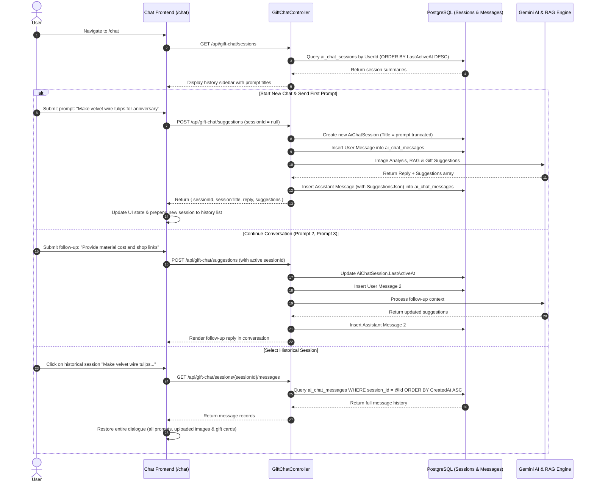

# Implementation Plan: ChatGPT-Style Chat History for Vision Plus

This document provides a comprehensive technical analysis, target architecture sequence flow, and an actionable implementation plan with **ready-to-use task prompts** for AI agents to integrate persistent, multi-turn chat sessions (similar to ChatGPT) into the Vision Plus feature of CraftVision 3D.

---

## 1. Current State Analysis

### 1.1. Frontend (`frontend/src/app/chat/page.tsx`)
* **Hardcoded Mock History:** The history dropdown renders a static array `mockHistory` with 4 dummy items ("Làm lồng đèn trung thu", "Quà sinh nhật cho bạn gái", etc.).
* **Single-Session Transient Storage:** `ChatPage` stores only the active chat messages inside browser `sessionStorage` (`craftvision_chat_messages_v1`), with no account-level persistence and no `currentSessionId`.
* **No Session Switching Interaction:** Clicking an item in the history list does not trigger any `onClick` event to fetch or render corresponding messages.
* **Payload Missing Session Context:** When sending a message via `fetchApi("/api/gift-chat/suggestions")`, the request payload contains only `{ userId, prompt, imageUrl, maxCost, occasion, difficulty }` without a `sessionId`.

### 1.2. Backend (.NET Microservices)
* **Pre-existing Database Schema & Repositories:**
  * Table `ai_chat_sessions`: Exists with `id`, `user_id`, `title`, `created_at`, `last_active_at`.
  * Table `ai_chat_messages`: Exists with `id`, `session_id`, `role`, `content`, `image_file_id`, `created_at`.
  * Repositories `AiChatSessionRepository` and `AiChatMessageRepository` are registered in DI.
* **Key Architecture Gaps:**
  1. **Disconnection Between Vision Plus and Session Storage:** The primary Vision Plus endpoint `GiftChatController` (`/api/gift-chat/suggestions`) executes `GenerateSuggestionsCommand` in isolation without persisting user queries or AI replies into `ai_chat_messages`.
  2. **Missing Rich Data Columns:** `AiChatMessage` only stores plain string `Content`. It lacks columns to persist the user's uploaded image URL (`image_url`) and the AI's structured gift suggestions (`suggestions_json`).
  3. **Missing Session Management Endpoints:** There are no dedicated Gift Chat endpoints to list user sessions, fetch historical messages with structured suggestions, delete sessions, or rename session titles.

---

## 2. Target Architecture & Sequence Flow



---

## 3. Implementation Plan Breakdown

| Task | Name | Scope & Files | Priority |
| :--- | :--- | :--- | :--- |
| **Task 1** | Entity Extension & Database Migration | `AiChatMessage.cs`, EF Core forward migration | High (Mandatory) |
| **Task 2** | Repositories & DTOs for Session Management | DTOs, `IAiChatSessionRepository`, `AiChatSessionRepository` | High |
| **Task 3** | Backend Logic & GiftChat Integration | `GenerateSuggestionsCommand`, `GiftChatController` | High |
| **Task 4** | Frontend API Client & State Helpers | `frontend/src/lib/chatSessionApi.ts` | Medium |
| **Task 5** | ChatGPT-Style Frontend UI/UX Overhaul | `frontend/src/app/chat/page.tsx` | High |
| **Task 6** | End-to-End Verification & Testing | Build checks, multi-turn chat testing | Medium |

---

## 4. Ready-to-Use Agent Prompts

You can copy and paste each prompt directly to an agent to execute the tasks sequentially:

### Prompt for Task 1: Entity Extension and Database Migration
```text
[TASK 1: DATABASE & ENTITY EXTENSION FOR CHAT HISTORY]
Please upgrade the database schema to support full session persistence for Vision Plus:
1. Open `backend/src/CraftVision.Domain/Entities/AiChatMessage.cs` and add two nullable properties:
   - `public string? ImageUrl { get; set; }` (Stores user attached image URL)
   - `public string? SuggestionsJson { get; set; }` (Stores serialized JSON array of AI gift suggestions, materials, and shop items)
2. In `backend/src/CraftVision.Infrastructure/Data/ApplicationDbContext.cs`, ensure column mappings for `image_url` and `suggestions_json` are configured as text.
3. Strictly adhere to AGENTS.md rules for Database Migrations: Generate a forward migration using dotnet CLI:
   `dotnet ef migrations add AddImageUrlAndSuggestionsToAiChatMessage --project backend/src/CraftVision.Infrastructure --startup-project backend/src/CraftVision.Presentation`
4. Review the generated migration script to guarantee that foreign key cascades remain intact and cloud deployment startup (db.Database.Migrate()) will succeed safely.
```

---

### Prompt for Task 2: Repositories & DTOs for Session Management
```text
[TASK 2: REPOSITORIES & DTOS FOR CHAT SESSIONS]
Please update the Application and Infrastructure layers to support chat session operations:
1. Create or update DTOs in `backend/src/CraftVision.Application/DTOs/Chat/`:
   - `ChatSessionSummaryDto.cs`: contains `Guid Id`, `string Title`, `DateTime CreatedAt`, `DateTime LastActiveAt`, `int MessageCount`, `string? LastMessagePreview`.
   - `ChatSessionDetailDto.cs`: contains session info and `List<ChatMessageItemDto>` (`Guid Id`, `string Role`, `string Content`, `string? ImageUrl`, `List<GiftSuggestionDto>? Suggestions`, `DateTime CreatedAt`).
   - `UpdateChatSessionTitleDto.cs`: contains `string Title`.
2. Extend `IAiChatSessionRepository` and `AiChatSessionRepository`:
   - Add `Task DeleteSessionAsync(Guid sessionId, Guid userId);` to safely remove a session and cascade delete its messages.
   - Add `Task UpdateTitleAsync(Guid sessionId, Guid userId, string newTitle);`.
   - Add `Task<IEnumerable<AiChatMessage>> GetSessionMessagesWithDetailsAsync(Guid sessionId, Guid userId);`.
3. Ensure every query enforces `UserId` ownership verification to prevent cross-user data exposure.
```

---

### Prompt for Task 3: Integrate Sessions into Gift Chat Backend
```text
[TASK 3: INTEGRATE SESSIONS INTO GIFT CHAT BACKEND]
Please connect Vision Plus chat execution with session persistence:
1. Update `GenerateSuggestionsCommand.cs`:
   - Add `public Guid? SessionId { get; set; }`.
   - Update `GiftChatResponseDto.cs` to return `Guid SessionId` and `string SessionTitle`.
2. In `GenerateSuggestionsCommandHandler`:
   - If `request.SessionId` is null/empty: Create a new `AiChatSession` with `UserId = request.UserId` and derive `Title` from the first prompt (truncated to 40 characters) or fallback to "Gift Consultation".
   - If `request.SessionId` is provided: Verify ownership, update `session.LastActiveAt = DateTime.UtcNow`. If title was default or empty, update it with current prompt.
   - Insert user message into `AiChatMessage` with `Role = MessageRole.User`, `Content = request.Prompt`, `ImageUrl = request.ImageUrl`.
   - Upon successful suggestion generation, insert AI response into `AiChatMessage` with `Role = MessageRole.Assistant`, `Content = response.Reply`, `SuggestionsJson = JsonSerializer.Serialize(response.Suggestions)`.
3. Add RESTful endpoints to `backend/src/CraftVision.Presentation/Controllers/GiftChatController.cs`:
   - `GET /api/gift-chat/sessions`: Returns user sessions ordered by `LastActiveAt` descending.
   - `GET /api/gift-chat/sessions/{sessionId}/messages`: Returns all messages in session, deserializing `SuggestionsJson` into structured suggestion objects.
   - `DELETE /api/gift-chat/sessions/{sessionId}`: Deletes the specified user session.
   - `PATCH /api/gift-chat/sessions/{sessionId}/title`: Renames the session title.
```

---

### Prompt for Task 4: Frontend API Client Module
```text
[TASK 4: FRONTEND API CLIENT & SERVICES]
Please create a dedicated frontend chat session client module at `frontend/src/lib/chatSessionApi.ts`:
1. Define TypeScript interfaces:
   - `ChatSessionSummary`: `{ id: string; title: string; createdAt: string; lastActiveAt: string; messageCount?: number; }`
   - `ChatMessageRecord`: `{ id: string; role: 'user' | 'ai'; content: string; imageUrl?: string; suggestions?: any[]; createdAt: string; }`
2. Implement API functions using `fetchApi`:
   - `getChatSessions()`: Invokes `GET /api/gift-chat/sessions`.
   - `getSessionMessages(sessionId: string)`: Invokes `GET /api/gift-chat/sessions/${sessionId}/messages`.
   - `deleteChatSession(sessionId: string)`: Invokes `DELETE /api/gift-chat/sessions/${sessionId}`.
   - `renameChatSession(sessionId: string, title: string)`: Invokes `PATCH /api/gift-chat/sessions/${sessionId}/title`.
3. Provide robust error handling and graceful fallbacks when the user is unauthenticated or in demo mode.
```

---

### Prompt for Task 5: Upgrade Chat UI to ChatGPT-Style Sessions
```text
[TASK 5: UPGRADE CHAT UI TO CHATGPT-STYLE SESSIONS]
Please upgrade `frontend/src/app/chat/page.tsx` to support ChatGPT-style session interactions:
1. Replace `mockHistory` with dynamic session data retrieved via `getChatSessions()`.
2. Manage session lifecycle state:
   - Introduce `currentSessionId: string | null`.
   - Check URL query parameter `?session={id}` on initial mount: if present, call `getSessionMessages(sessionId)` and populate the conversation view.
3. Message dispatching (`handleSend`):
   - Include `sessionId: currentSessionId` in the payload sent to `/api/gift-chat/suggestions`.
   - When the response arrives, update `currentSessionId = res.sessionId`, update browser URL via `window.history.replaceState` without triggering a reload, and refresh the history session list.
4. "+ New Chat" Button (`handleResetChat`):
   - Reset `currentSessionId = null`, clear current dialogue to default welcome message, and strip `?session` query parameter from the URL.
5. Enhanced History Drawer/Dropdown:
   - Categorize sessions by relative date: "Today", "Yesterday", "Previous 7 Days", "Older".
   - Each item displays the first prompt summary with a delete trash button (with confirmation).
   - Clicking a session loads its full dialogue and closes the history drawer.
   - Display a clean loading skeleton / spinner while messages are being fetched.
```

---

### Prompt for Task 6: Verification & End-to-End Testing
```text
[TASK 6: VERIFICATION & TESTING CHAT HISTORY]
Please run build validations and verify end-to-end chat history workflows:
1. Run `npm run build --prefix frontend` to ensure zero TypeScript, build, or syntax errors.
2. Verify primary user workflows:
   - Scenario 1: Open New Chat -> Send prompt 1 "Birthday gift idea for best friend under 500k" -> Verify session is created with prompt 1 summary as title.
   - Scenario 2: Send prompt 2 "Do you have matching gift box materials?" -> Verify message 2 appends to the same session.
   - Scenario 3: Click "+ New Chat" -> Submit a different prompt -> Confirm a 2nd session is generated.
   - Scenario 4: Open History menu -> Confirm both sessions appear -> Click Session 1 -> Confirm all 2 prompts, AI replies, and gift cards restore accurately.
   - Scenario 5: Delete Session 2 -> Confirm it is removed from history.
```

---

## 5. Definition of Done (Acceptance Criteria)

* [ ] Logged-in users see their real historical conversations.
* [ ] The first prompt of a new session automatically forms the session's title summary.
* [ ] A single session persists multiple conversational turns (Prompt 1, Prompt 2, Prompt 3...) durably in PostgreSQL.
* [ ] Selecting any historical session restores 100% of user prompts, attached images, AI replies, and interactive suggestion cards.
* [ ] Users can start a clean conversation at any time via the "+ New Chat" action.
* [ ] Users can delete unwanted sessions from their history.
* [ ] Both backend (`dotnet build`) and frontend (`next build`) compile with zero errors.
